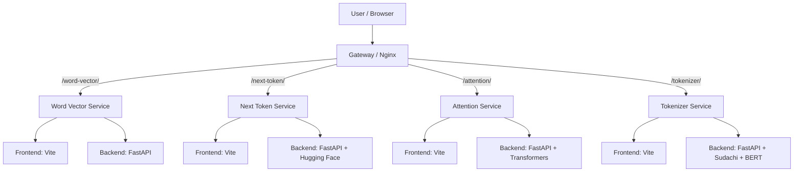

# AI-UCDS LLM WebApp 仕様書

## 1. 目的

本システムは、AI-UCDS に含まれる複数の LLM 可視化アプリを 1 つの Web アプリとして統合し、Docker Compose および Azure Web App for Containers 上で同一の運用モデルで提供することを目的とする。

- 入口となる gateway でパスベースルーティングを実施する
- 各可視化アプリを独立したコンテナとして動作させる
- ローカル開発と Azure デプロイを共通の構成で実現する
- 実際の可視化ロジックを各サブモジュールで実装し、統合層で集約する

## 2. 対象範囲

### 2.1 対象システム
- gateway
- apps/base
- apps/src/word-vector
- apps/src/next-token
- apps/src/attention
- apps/src/tokenizer

### 2.2 対象外
- 各サブモジュールの詳細ロジック（本リポジトリでは参照/統合層のみ）
- モデル学習プロセス
- 本番運用のセキュリティ監査やIAMポリシー設計

## 3. システム概要

本リポジトリは単一アプリではなく、複数の LLM 可視化アプリを束ねる「統合ポータル」型の構成を採用している。リクエストは gateway で受け取り、各アプリごとのパスに振り分ける。

- `/` : 統合入口画面
- `/word-vector/` : Word Vector Visualizer
- `/next-token/` : Next Token Predictor
- `/attention/` : Attention Visualizer
- `/tokenizer/` : Tokenizer Visualizer

## 4. アーキテクチャ

### 4.1 全体構成



### 4.2 コンポーネント責務

| コンポーネント | 説明 | 主な責務 |
|---|---|---|
| gateway | エントリーポイント | Nginx によるパス別ルーティング、静的ページ配信 |
| apps/base | 共通ビルド基盤 | frontend build、backend runtime、nginx + supervisord 設定 |
| apps/src/word-vector | 単語ベクトル可視化 | 埋め込み、2D投影、類似度マトリクス |
| apps/src/next-token | 次トークン予測 | モデル推論、候補トークンの可視化 |
| apps/src/attention | Attention 可視化 | attention matrix の描画 |
| apps/src/tokenizer | トークナイズ可視化 | 形態素解析と BERT subword 分割表示 |

## 5. 物理構成

```text
AI-UCDS-llm-webapp/
├── README.md
├── docker-compose.yml
├── .gitmodules
├── gateway/
│   ├── index.html
│   ├── nginx.conf
│   ├── nginx.azure.conf
│   └── Dockerfile
├── apps/
│   ├── base/
│   │   ├── Dockerfile
│   │   ├── nginx-app.conf
│   │   ├── supervisord.conf
│   │   └── rewrite-api.cjs
│   └── src/
│       ├── word-vector/   (submodule)
│       ├── next-token/    (submodule)
│       ├── attention/     (submodule)
│       └── tokenizer/     (submodule)
├── .github/
│   └── workflows/
│       └── ci-cd.yml
└── LICENSE
```

## 6. 実行モデル

### 6.1 ローカル起動

```bash
docker compose up --build
```

起動後、以下の URL にアクセスできる。

- http://localhost/
- http://localhost/word-vector/
- http://localhost/next-token/
- http://localhost/attention/
- http://localhost/tokenizer/

### 6.2 Azure での展開

README に記載されている通り、Azure Web App for Containers の Compose モードで用いる前提で構成されている。

1. GitHub へ push
2. Azure Container Registry を作成
3. Linux App Service Plan を作成
4. Web App をマルチコンテナとして構成
5. 本リポジトリの compose 設定を利用

## 7. 実装の基本設計

### 7.1 共通 Docker 実行基盤

apps/base/Dockerfile は以下の流れで実行される。

1. Node.js 20 を利用して frontend を build
2. Vite の dist を生成
3. Python 3.11 環境を用意
4. 各アプリの backend/requirements.txt を install
5. FastAPI サーバーと Nginx を supervisord で同時起動
6. 8080 番ポートで受け付け

### 7.2 アプリごとの起動方式

docker-compose.yml は各サービスごとに以下の形式で動作する。

```yaml
word-vector:
  build:
    context: .
    dockerfile: apps/base/Dockerfile
    args:
      APP_DIR: apps/src/word-vector
      APP_SLUG: word-vector
      BACKEND_MODULE: app.main:app
```

- APP_DIR: 対象サブモジュールのパス
- APP_SLUG: サブパス名（例: /word-vector）
- BACKEND_MODULE: uvicorn 起動モジュール

### 7.3 Nginx によるルーティング

gateway/nginx.conf では、以下の forwarding を行う。

```nginx
location /word-vector/ { proxy_pass http://word-vector:8080/; }
location /next-token/ { proxy_pass http://next-token:8080/; }
location /attention/ { proxy_pass http://attention:8080/; }
location /tokenizer/ { proxy_pass http://tokenizer:8080/; }
```

これにより、各アプリの内部 API をパスベースで統合公開できる。

## 8. サブモジュール連携

.gitmodules により以下のリポジトリが導入される。

- apps/src/word-vector → AI-UCDS-llm-word-vector-visualizer
- apps/src/next-token → AI-UCDS-llm-next-token-predictor
- apps/src/attention → AI-UCDS-llm-attention-visualizer
- apps/src/tokenizer → AI-UCDS-llm-tokenizer-visualizer

### 8.1 設計上の意図

- 統合ポータルとしての共通機能を webapp 側に保持
- 各アプリの実装は専門化された個別リポジトリとして管理
- 開発単位とデプロイ単位の分離が可能

## 9. 非機能要件

### 9.1 可用性
- 各アプリは独立コンテナで動作するため、個別障害を分離可能
- gateway 側のダウン時は全体アクセスが止まるため、入口の冗長性を要検討

### 9.2 互換性
- Docker Compose の定義が CI 上で構文検証される
- Azure Web App for Containers とローカル Docker の両立を意図

### 9.3 性能
- next-token は Hugging Face モデルのロードに時間がかかる
- volume `hf-cache` を定義してモデルキャッシュを保持する

### 9.4 保守性
- 共通ランタイムを apps/base に集約
- 新規可視化アプリを submodule として追加しやすい

## 10. 監視・CI/CD

GitHub Actions の `ci-cd.yml` では、push 時に以下を実行する。

```yaml
- run: docker compose config
```

このため、compose ファイルの構文崩れや定義ミスを事前に検出する。運用上は依然として実行の健全性確認が必要であるが、最低限の構成検証は行われている。

## 11. 制約事項

- gateway は単一の入口であり、各アプリの詳細な認証機能は含まれていない
- 本リポジトリでは各アプリの機能の詳細設計を直接管理せず、サブモジュールに委譲している
- next-token などの大規模モデル系アプリでは初期ロード時間が長くなる可能性がある

## 12. まとめ

本システムは、AI-UCDS の複数の LLM 可視化機能を 1 つの Web アプリとして統合するための「統合層 + サブモジュール群」のアーキテクチャを持つ。Infrastructure とアプリ実装を分離し、各コンポーネントを独立して管理できる設計が特徴である。

## 13. 参考ファイル

- README.md
- docker-compose.yml
- .gitmodules
- gateway/nginx.conf
- gateway/nginx.azure.conf
- apps/base/Dockerfile
- apps/base/supervisord.conf
- apps/base/nginx-app.conf
- .github/workflows/ci-cd.yml

---

本書は、実装と構成が確認できた範囲に基づく仕様書であり、詳細な可視化ロジックの仕様については各サブモジュール側を参照する前提とする。

