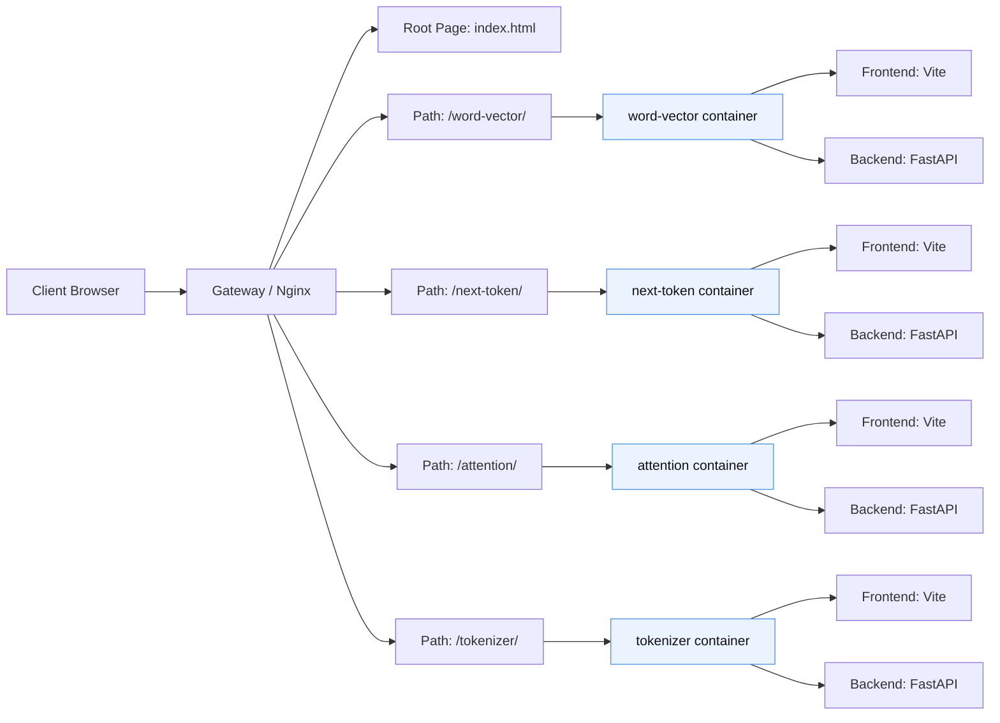
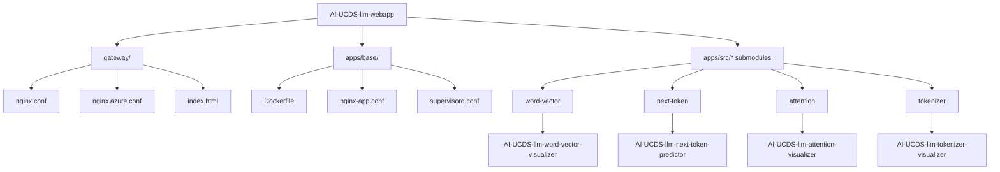
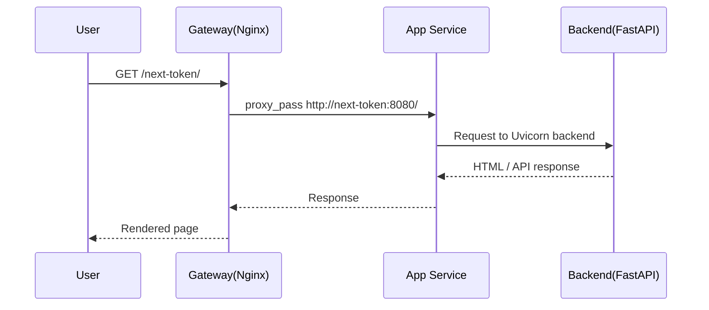

# AI-UCDS LLM WebApp 構成図・システム設計

## 1. 全体構成図



## 2. 依存関係図



## 3. 実行シーケンス



## 4. パス別責務

| パス | ルーティング先 | 役割 |
|---|---|---|
| `/` | gateway の root index.html | 入口一覧 |
| `/word-vector/` | word-vector service | 単語ベクトル可視化 |
| `/next-token/` | next-token service | 次トークン予測 |
| `/attention/` | attention service | Attention 可視化 |
| `/tokenizer/` | tokenizer service | 形態素解析・BERT トークナイズ可視化 |

## 5. 役割整理

### 5.1 gateway
- Nginx を使用
- `/` 配下の静的入口ページを提供
- 各パスを対応コンテナに proxy pass
- Docker Compose のネットワーク上で通信

### 5.2 apps/base
- 全アプリ共通の Dockerfile
- frontend build で dist を生成
- python backend を起動
- nginx と supervisor でバックエンドと静的配信を管理

### 5.3 app ごとの責務

#### word-vector
- `SentenceTransformer` で単語 embedding
- `PCA` / `UMAP` により 2D 投影
- 類似度マトリクスを計算

#### next-token
- `AutoTokenizer` と `AutoModelForCausalLM` を用いて次トークン生成
- 候補トークンと probability を返す
- `trace` を含む生成履歴を提供

#### attention
- Hugging Face の attention 出力を平均化
- [CLS]/[SEP] を除外して表示可能な行列を生成

#### tokenizer
- Sudachi による形態素解析
- BERT tokenizer を使った subword 表示

## 6. 実装上の設計意図

- gateway は統合入口として機能する
- 各可視化機能は独立したサービスとして実装
- すべてのサービスは同じ共通実行基盤で起動される
- 実際の可視化ロジックと UI はサブモジュールに分離されている

## 7. デプロイ構成

```text
Internet
   │
   ▼
Azure App Service (Linux / Multi-container)
   │
   ├── gateway container
   │   └── Nginx reverse proxy
   │
   ├── word-vector container
   ├── next-token container
   ├── attention container
   └── tokenizer container
```

## 8. 運用上の注意点

- next-token はモデルの初期ロードに時間を要する
- GPU/CUDA を使う場合と CPU を使う場合の差異がある
- HF モデルキャッシュの保存が必要
- 中央 gateway が停止すると統合アクセスが失われる

## 9. 設計の結論

本システムの中心概念は、「複数の可視化アプリを、単一の入口と共通基盤で束ねること」である。これにより、アプリごとの独立性を維持しつつ、ユーザーは 1 つの URL で総合的なアクセスを行える。

