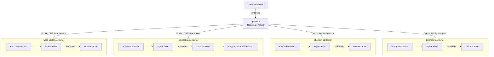

# AI-UCDS LLM WebApp 設計書（HLD / LLD）

## 1. 文書の位置づけ

本書は、要件定義（`04-requirements-srs.md`）を実装構成へ対応付ける High-Level Design / Low-Level Design の概要である。確認済みの実装事実と、今後決めるべき設計事項を区別して記述する。

## 2. High-Level Design

### 2.1 コンテナ構成



### 2.2 ネットワークとポート

| 項目 | 設定 |
|---|---|
| ホスト公開 | gateway の `80:80` |
| Gateway → アプリ | Compose service name とコンテナポート `8080` |
| アプリ内 Nginx | `0.0.0.0:8080` |
| アプリ内 Uvicorn | `127.0.0.1:8000` |
| API 経路 | 公開サブパス + `/backend/` → 内部の FastAPI route |

各アプリの backend と app Nginx は同じコンテナ内にあり、バックエンドの 8000 番ポートは外部公開しない設計である。

### 2.3 デプロイ構成

- ローカル: Compose が gateway と4アプリを build/run する。
- Azure: `gateway/Dockerfile.azure` と `gateway/nginx.azure.conf` が Azure 向け入口設定を提供する。README は Web App for Containers の Compose 運用を案内している。
- CI: GitHub Actions は push 時に `docker compose config` を実行する。現在確認できた workflow には実イメージ build や Azure deploy は含まれていない。

## 3. Low-Level Design

### 3.1 Gateway

- `gateway/index.html`: 日本語 locale の入口HTML、各アプリへの anchor link。
- `gateway/nginx.conf`: ローカルCompose向け。末尾スラッシュ補完と Docker service 名への proxy。
- `gateway/nginx.azure.conf`: Azure向け。各 proxy に HTTP/1.1、Connection header、長めの read timeout を設定。
- `gateway/Dockerfile`: `nginx:1.27-alpine` を基に設定と index をコピー、80番を expose。
- `gateway/Dockerfile.azure`: Azure向けNginx設定をコピーする別イメージ定義。

### 3.2 共通アプリ Dockerfile

`apps/base/Dockerfile` は multi-stage build。

1. **Frontend stage**: `node:20-slim`。`APP_DIR/frontend` の package manifest を使って依存を install し、`npm run build -- --base=./` を実行。
2. **API path rewrite**: `rewrite-api.cjs` を `APP_SLUG` と `src` に対して実行し、localhost絶対URLや `/api/` 形式をアプリサブパス向けに書き換える。
3. **Runtime stage**: `python:3.11-slim`。nginx、supervisor、コンパイル関連ツールを install。Rust toolchain も導入。
4. `APP_DIR/backend/requirements.txt` と backend source を配置。
5. frontend build artifact を `/usr/share/app/dist` にコピー。
6. `supervisord` をフォアグラウンドで起動。

### 3.3 アプリ内プロセス管理

- `apps/base/supervisord.conf` は Uvicorn と Nginx を同一コンテナで管理し、autorestart を有効にする。
- Uvicorn module は Compose の `BACKEND_MODULE` で指定する。
- Nginx は `/` を静的配信し、SPA fallback として `/index.html` を利用する。
- `/backend/` は `127.0.0.1:8000/` に proxy する。backend の各 FastAPI route はこの prefix を除いた内部パスとして実装されている。

### 3.4 サービス設定

| Compose service | APP_SLUG | BACKEND_MODULE | 固有設定 |
|---|---|---|---|
| word-vector | `word-vector` | `app.main:app` | なし |
| next-token | `next-token` | `app.main:app` | MODEL_ID、CPU、生成設定、HF cache volume |
| attention | `attention` | `main:app` | FastAPI entrypoint は `backend/main.py` |
| tokenizer | `tokenizer` | `app.main:app` | 日本語 tokenizer 系依存 |

### 3.5 解析機能の内部処理

- **Word Vector**: `EmbeddingService.encode()` → `project_to_2d()` (PCAまたはUMAP) → `build_matrix()` → `AnalyzeResponse`。
- **Next Token**: `load_model()` で tokenizer/model を cache → `generate_text_with_trace()` で生成と候補確率を作成 → `GenerationResponse`。
- **Attention**: tokenizer/model を startup でロード → `output_attentions=True` で推論 → layer/head average → special token を除外して matrix を返却。
- **Tokenizer**: `JapaneseTextAnalyzer` が Sudachi SplitMode C で形態素解析し、品詞と BERT subword/token ID を返却。

## 4. データフロー

```mermaid
sequenceDiagram
  participant U as User
  participant G as Gateway
  participant N as App Nginx
  participant F as Frontend
  participant B as FastAPI
  participant M as Model/Analyzer

  U->>G: GET /tokenizer/
  G->>N: proxy to tokenizer service, strip /tokenizer prefix
  N->>F: serve index.html and Vite assets
  F-->>U: render UI
  U->>F: enter text and submit
  F->>G: POST /tokenizer/backend/analyze
  G->>N: forward to tokenizer service
  N->>B: proxy /backend/ to localhost:8000; route /analyze
  B->>M: Sudachi + BERT tokenize
  M-->>B: token analysis result
  B-->>U: JSON response through Nginx and gateway
```

## 5. 設定管理

### 5.1 next-token の Compose 環境変数

| 変数 | Compose値 | 用途 |
|---|---|---|
| `MODEL_ID` | `sbintuitions/sarashina2.2-0.5b` | 使用モデル |
| `DEVICE` | `cpu` | 推論デバイス |
| `MAX_NEW_TOKENS` | `48` | 生成上限設定 |
| `TOP_K` | `8` | trace候補数の設定 |
| `TEMPERATURE` | `0.8` | sampling温度 |
| `HF_HOME` | `/models` | HFキャッシュ位置 |

named volume `hf-cache` は `/models` に mount する。

## 6. 開発・保守上の設計判断

- 共通Dockerfileを使い、アプリ差分を build args で渡す。
- アプリロジックと統合インフラを別リポジトリに分ける。
- submodule はコミット参照で固定されるため、submodule branch の更新だけでは親リポジトリの参照は自動更新されない。更新時は親repoの submodule commit を更新する。

## 7. 設計上の未決事項 / 推奨改善

- Compose `depends_on` のみでは backend readiness を保証しない。healthcheck と依存条件を追加する。
- API health endpoint の形式を共通化する。
- 現行CIは Compose 構文検証に限定される。build、smoke test、submodule checkout の検証を追加する。
- TLS、認証、リクエスト上限、モデルキャッシュ容量、ログ保持を本番要件として定義する。
- API rewrite の変換対象と各アプリの実際の endpoint を統合テストで検証する。
