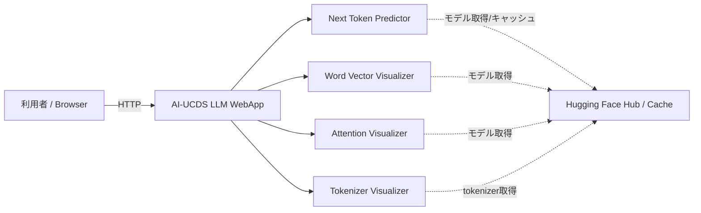
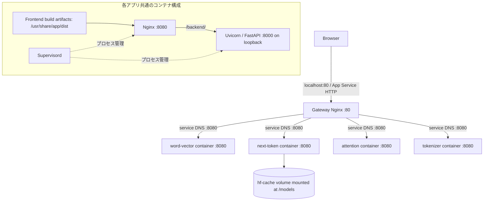
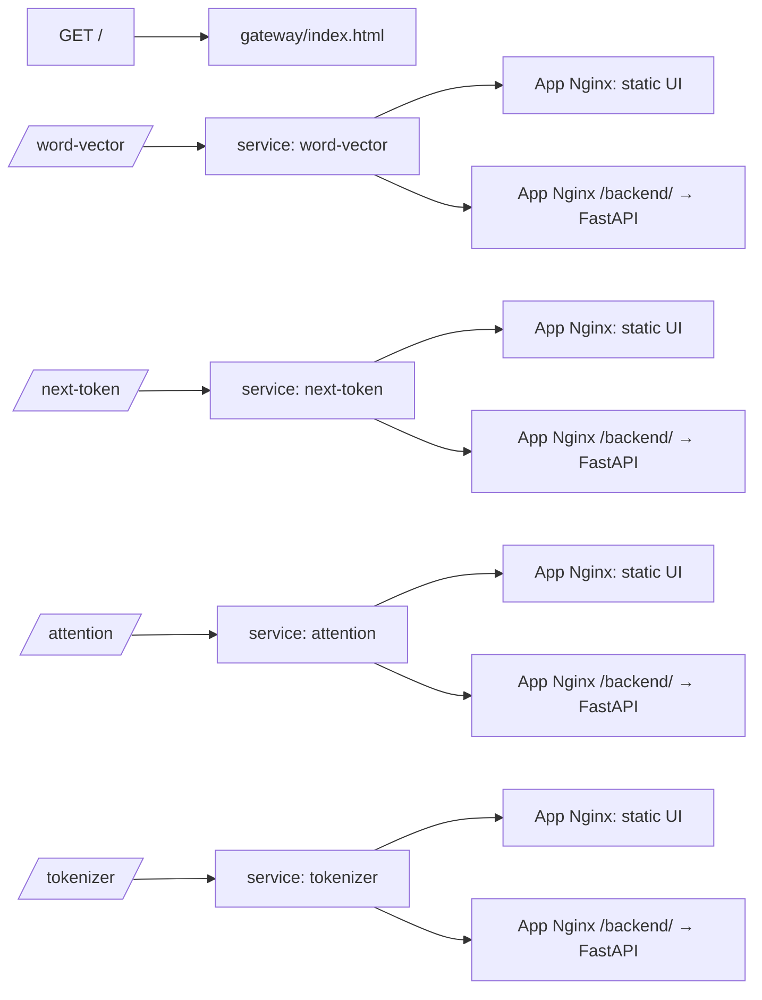
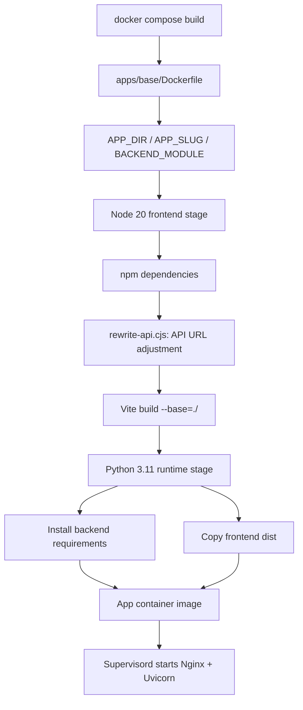
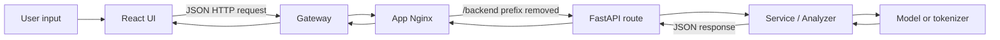

# AI-UCDS LLM WebApp Mermaid 構成図

本ファイルは、READMEや設計書へ転記できる構成図の独立版である。

## 1. システムコンテキスト図

## 2. コンテナ構成図

## 3. URLルーティング図

## 4. ビルドシーケンス

## 5. アプリ内部処理フロー

## 6. 注意

- Gateway Nginx はサービス名を使い、各アプリコンテナのポート8080へ転送する。
- アプリ内 Nginx は `/backend/` を `127.0.0.1:8000/` へ転送する。
- 統合ビルド時の API URL 調整は `apps/base/rewrite-api.cjs` による。
- 図は現行コードの構成を表す。healthcheck、TLS終端、認証、冗長化は図示/実装されていない。
